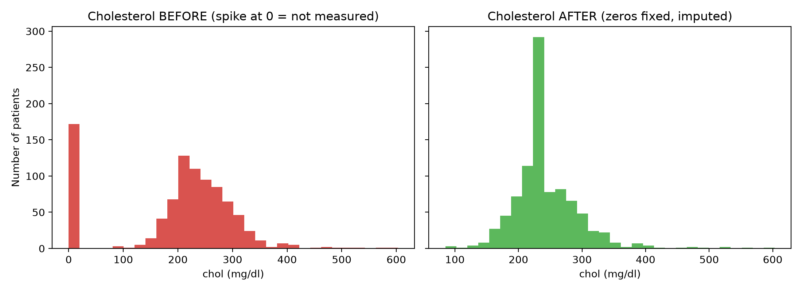

# Data Quality Audit Report: UCI Heart Disease Dataset

**Author:** Clement Yaw Amegashie
**Program:** CodeNova Internship, Batch 01, Data Science, Task 2 (Data Cleaning Report)
**Scope:** Diagnose, clean and document four hospital files. Describes **data quality only**; no clinical conclusions are drawn.

---

## 1. Executive summary

Four hospital files (Cleveland, Hungarian, Switzerland, VA; 920 patient records, 14 attributes) were combined and audited.
The raw data contained **1,759 missing values**, **185 impossible values** and **2 duplicate rows**.
After cleaning, the dataset has **916 rows, 12 feature columns, 0 missing values, 0 impossible values and 0 duplicates**.
Only **4 rows (0.4%)** were removed. Most problems were fixed by correcting or imputing values rather than deleting patients.

Two limitations matter to anyone reusing the data:
1. **Switzerland has no real cholesterol data** (all 123 values were recorded as 0), so its `chol` values are entirely imputed.
2. **`ca` and `thal` were dropped** because they were mostly missing (66% and 53%) and almost absent outside Cleveland.

---

## 2. Data sources

| Source file | Rows |
|---|---|
| processed.cleveland.data | 303 |
| processed.hungarian.data | 294 |
| processed.va.data | 200 |
| processed.switzerland.data | 123 |
| **Total** | **920** |

Source: UCI Machine Learning Repository, Heart Disease dataset. The `processed.*` files were used because the dataset's own documentation warns that `cleveland.data` is corrupted. The files have no header row, so the 14 standard column names were added from the documentation, and a `source` column was created to track each record's hospital.

The raw files in `data/raw/` are **never modified**. All outputs are written to `data/clean/` and `reports/`.

---

## 3. Diagnostic findings

### 3.1 Missing values (explicit, marked with `?`)

| Column | Missing | % of 920 |
|---|---|---|
| ca | 611 | 66.4% |
| thal | 486 | 52.8% |
| slope | 309 | 33.6% |
| fbs | 90 | 9.8% |
| oldpeak | 62 | 6.7% |
| trestbps | 59 | 6.4% |
| thalach | 55 | 6.0% |
| exang | 55 | 6.0% |
| chol | 30 | 3.3% |
| restecg | 2 | 0.2% |

**Missingness depends on the hospital, not on chance.** `ca` is missing in 99% of Hungarian, 99% of VA and 96% of Switzerland records, but only 1% of Cleveland records. The VA file is missing 26 to 28% of `trestbps`, `thalach`, `exang` and `oldpeak`, while Cleveland has almost none.

### 3.2 Disguised missing values (look real, but are not)

| Issue | Count | Where |
|---|---|---|
| `chol = 0` | 172 | Switzerland 123 (every row), VA 49 |
| `trestbps = 0` | 1 | VA |
| `oldpeak < 0` | 12 | Switzerland 11, VA 1 |

A cholesterol or blood pressure of 0 is physiologically impossible and means "not measured". Negative `oldpeak` (ST depression) is not described in the documentation and is treated as invalid. These 185 values were invisible to a simple null count.

### 3.3 Data types

All columns were read as text because of the `?` markers. Numeric columns were converted with `pd.to_numeric`, and integer-coded categorical columns were cast back to integers after imputation.

### 3.4 Duplicates

2 exact duplicate rows were found.

### 3.5 Outliers (IQR method, after impossible zeros were set to missing)

Fences: Q1 − 1.5×IQR and Q3 + 1.5×IQR.

| Column | Q1 | Q3 | Low fence | High fence | Outliers | Range flagged |
|---|---|---|---|---|---|---|
| age | 47.0 | 60.0 | 27.5 | 79.5 | 0 | none |
| trestbps | 120.0 | 140.0 | 90.0 | 170.0 | 27 | 80 to 200 |
| chol | 210.0 | 276.8 | 109.9 | 376.9 | 23 | 85 to 603 |
| thalach | 120.0 | 157.0 | 64.5 | 212.5 | 2 | 60 to 63 |
| oldpeak | 0.0 | 1.5 | −2.2 | 3.8 | 16 | −2.6 to 6.2 |

---

## 4. Cleaning decisions and justification

Every action below is recorded automatically in `reports/cleaning_log.csv`.

| # | Action | Rows / values affected | Justification |
|---|---|---|---|
| 1 | `chol = 0` set to missing | 172 | Impossible value; means not measured |
| 2 | `trestbps = 0` set to missing | 1 | Impossible value |
| 3 | `oldpeak < 0` set to missing | 12 | Not valid per documentation |
| 4 | Duplicate rows dropped | 2 | Same record entered twice |
| 5 | Columns `ca` and `thal` dropped | 609 and 484 missing (of 918 rows) | Over 50% missing and concentrated in 3 of 4 hospitals; imputing would invent most of the column |
| 6 | Rows with missing `restecg` dropped | 2 | Under 1% of data; negligible loss, avoids imputation bias |
| 7 | Numeric columns imputed with the **median** | trestbps 60, chol 200, thalach 55, oldpeak 74 | The median is robust to the extreme values that were deliberately kept |
| 8 | Categorical columns imputed with the **mode** | fbs 89, exang 55, slope 306 | Most frequent category used for coded columns |

**Outlier policy: flagged, not deleted.** All remaining IQR outliers (blood pressure 80 to 200, cholesterol 85 to 603, peak heart rate 60 to 63, `oldpeak` up to 6.2) are physiologically possible, so they were kept as real extremes. Removing them would delete exactly the unusual patients the data exists to describe. The only invalid outliers were the impossible zeros and negative `oldpeak` values handled in steps 1 to 3.

**Traceability:** for every imputed column a `<column>_was_missing` flag (0 or 1) was added, so analysts can always tell real values from filled ones.

---

## 5. Before and after

| Metric | Before | After |
|---|---|---|
| Rows | 920 | 916 |
| Feature columns | 14 | 12 |
| Missing values (NaN) | 1,759 | 0 |
| Impossible values | 185 | 0 |
| Duplicate rows | 2 | 0 |

| Column | Mean (before → after) | Median (before → after) | Std (before → after) | Nulls (before → after) |
|---|---|---|---|---|
| trestbps | 132.1 → 132.2 | 130.0 → 130.0 | 19.1 → 17.9 | 59 → 0 |
| chol | 199.1 → 245.2 | 223.0 → 239.5 | 110.8 → 51.9 | 30 → 0 |
| thalach | 137.5 → 137.7 | 140.0 → 140.0 | 25.9 → 25.2 | 55 → 0 |
| oldpeak | 0.9 → 0.9 | 0.5 → 0.5 | 1.1 → 1.0 | 62 → 0 |



### Interpreting the cholesterol change

- **The mean rose from 199.1 to 245.2 mg/dl** because 172 impossible zeros had been pulling it down. Once these were set to missing and replaced with the median (239.5), the mean reflects realistic values.
- **The standard deviation fell from 110.8 to 51.9** for two reasons. First, the zeros sat roughly 245 mg/dl away from typical readings, which inflated the spread. Second, 200 values (21.8% of 916 rows) were then filled with one identical number (239.5), which compresses the spread artificially. The first effect is a genuine correction. The second is lost variation, not better data.

---

## 6. Limitations

1. **Switzerland's cholesterol is entirely imputed.** Comparing cholesterol between hospitals would be misleading.
2. **Median imputation reduces variance** and weakens relationships involving `chol`, `trestbps`, `thalach`, `oldpeak` and `slope`. `slope` is the weakest: 306 of 916 values (33.4%) were filled with the most common category.
3. **`ca` and `thal` were dropped**, so any analysis needing those attributes would have to use the Cleveland file alone.
4. **Imputation used the global median or mode**, not hospital-specific values, because Switzerland has no real cholesterol data to base one on.
5. **Medical validity was judged from general plausibility and the dataset documentation**, not by a clinician.

---

## 7. Reproducibility

```
python src/clean.py      # raw -> data/clean/heart_disease_clean.csv + reports/cleaning_log.csv
python src/compare.py    # before/after tables + chart in reports/
```

Raw data is only read, never written. Running the scripts twice produces identical output.
